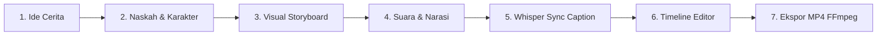

# Analisa: Ikhtisar & Arsitektur Project Bang Story

## 1. Ringkasan Proyek
**Bang Story** adalah aplikasi desktop berbasis **Electron + React 19 + TypeScript + Vite + Tailwind CSS v4** yang dirancang untuk mengotomasi alur pembuatan video YouTube dari ide cerita hingga file MP4 siap unggah.

Aplikasi ini mengintegrasikan:
- **LLM (Gemini / OpenAI-compatible)**: Pembuatan naskah cerita, rencana visual (storyboard/prompt), dan prompt musik.
- **Higgsfield AI**: Generasi gambar klip, video pendek, dan konsistensi karakter.
- **TTS (Gemini Audio / ElevenLabs)**: Pembuatan narasi suara per klip atau narasi utuh satu rekaman.
- **Whisper.cpp (Lokal)**: Transkripsi audio otomatis untuk sinkronisasi caption kata-demi-kata (word-level timestamps).
- **FFmpeg (ffmpeg-static)**: Rendering akhir timeline, stitching video, layering audio & musik, serta pembakaran subtitle/caption ke MP4.
- **SQLite (better-sqlite3)**: Database lokal untuk persistensi proyek, klip, karakter/pemeran, aset, dan riwayat pekerjaan.

---

## 2. Struktur Direktori Utama

```
bang-story/
├── resources/           # Binary whisper-cli, DLL, lisensi, dan font bawaan
├── src/
│   ├── main/           # Proses utama Node/Electron (DB, FFmpeg, AI Service, IPC)
│   │   ├── db/         # SQLite schema & skrip migrasi (user_version)
│   │   ├── services/   # Klien API eksternal (gemini, elevenlabs, higgsfield, audio, llm)
│   │   ├── ipc.ts      # IPC Handler penghubung Main & Renderer
│   │   ├── story.ts    # Alur pembuatan naskah & prompt visual
│   │   ├── narration.ts# Perekaman narasi utuh & split adegan
│   │   ├── whisper.ts  # Eksekusi binary whisper lokal untuk transkripsi
│   │   ├── exporter.ts # Engine render video dengan FFmpeg
│   │   └── secrets.ts  # Penyimpanan aman API key via safeStorage / DPAPI
│   ├── preload/        # Bridge isolasi konteks (window.api)
│   ├── shared/         # Aturan bersama Main & Renderer (motion, caption, types, timeline)
│   └── renderer/       # UI React 19 (Tailwind v4, Zustand store)
│       └── src/
│           ├── pages/project/  # Langkah: Ide, Naskah, Storyboard, Editor
│           └── store/          # Zustand store (project, editor state)
├── docs/               # Dokumentasi teknis komprehensif
└── analisa/            # Catatan analisis teknis & eksplorasi
```

---

## 3. Alur Kerja (Production Pipeline)



1. **Ide Cerita**: Pengguna memasukkan premis, genre, dan target audiens.
2. **Naskah**: AI membuat draft alur naskah terstruktur per adegan.
3. **Storyboard Visual**: Generate gambar/video melalui Higgsfield berdasarkan prompt dan referensi karakter.
4. **Suara**: TTS menghasilkan audio narator (baik potongan per klip maupun narasi utuh).
5. **Whisper Transcription**: Menyelaraskan kata-kata naskah dengan audio secara presisi untuk subtitle.
6. **Editor Timeline**: Pengguna memotong, mengatur durasi, transisi kamera, efek gerak, dan musik latar.
7. **Ekspor**: FFmpeg merender MP4 final dengan konfigurasi yang 100% konsisten dengan tampilan pratinjau.

---

## 4. Aturan Penting & Konvensi

1. **Kesesuaian Pratinjau vs Ekspor**: Logika kalkulasi gerak (`motion.ts`), penataan caption (`captions.ts`), dan potongan suara (`timeline.ts`) berada di `src/shared/` dan wajib dipakai bersama oleh renderer dan main process.
2. **BYOK (Bring Your Own Key)**: Kunci API disimpan lokal terenkripsi melalui `secrets.ts` dan tidak boleh bocor ke log atau diekspor.
3. **Database Migration**: Skema SQLite dikelola lewat array `MIGRATIONS` di `src/main/db/index.ts` secara sekuensial. Migrasi lama dilarang diubah.
4. **IPC Triad**: Setiap fitur IPC baru harus didefinisikan di:
   - `src/main/ipc.ts` (Handler)
   - `src/shared/api.ts` (TypeScript types)
   - `src/preload/index.ts` (Exposed API)
5. **Bahasa Antarmuka**: UI menggunakan Bahasa Indonesia santai ("kamu"), sedangkan kode dan komentar teknis menggunakan Bahasa Inggris.

---

## 5. Perintah Esensial Pengembangan

- `npm install`: Instalasi dependensi (otomatis compile better-sqlite3 via electron-builder).
- `npm run dev`: Jalankan aplikasi desktop dalam mode development (Vite hot reload).
- `npm run typecheck`: Validasi tipe TypeScript (node & web).
- `npm run build`: Kompilasi output ke folder `out/`.
